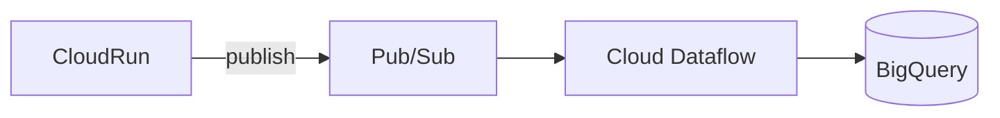
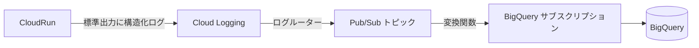

分析ログのためのインフラ構築なんていうのはただでさえ楽しくないのに、GCP での構築はかなり大変で苦痛でしたが、気付いたら大分楽にできるようになっていたという話です。

結論だけ知りたい人は [2026年最新式](#2026年最新式) へどうぞ。

## 従来の構成とその問題点

まず、従来の構成はこうなっていました。



この構成には、いくつかの問題があります。

### 構成が too much

なんといってもこれが一番大きい問題です。

Dataflow は普通にやろうとするとテーブル 1 つにつき常に GCE インスタンスを 1 台起動しておく必要があり、ログがまったく流れていなくてもお金がかかり続けます。パイプラインの構築も一手間かかるため初期工数が高く、テーブル追加の運用もしんどい。

分析ログを貯めたいだけのスモールスタートアップにとっては、明らかにオーバースペックでした。

[1 つのインスタンスで複数テーブルに流す方法](https://zenn.dev/malt03/articles/3401e5c54d7fcd)を考えて頑張ったりもしていました。

### Publish のためのネットワーク通信が必要

分析ログを流すたびに、アプリケーションから Pub/Sub への Publish というネットワーク通信が発生します。分析ログは基本的に「投げっぱなしで良い」ものなので、リクエストのたびに外部への通信が挟まるのは、レイテンシ的にもコード的にも嬉しくありません。

### オートスケールが弱い

Dataflow のオートスケールはそれほど機敏ではなく、急にトラフィックが増えたときの追従性に不安があります。

## 2026年最新式

新しい構成では、Dataflow を完全に排除します。



ポイントは、**アプリケーションからは標準出力に構造化ログを吐くだけ**という点です。あとは GCP のマネージドな仕組みだけでデータが BigQuery まで流れていきます。

わかる人は [構築コマンド](#付録-構築コマンド) を見た方が分かりやすいし簡単さが伝わるかもしれません。

順番に見ていきます。

### 1. CloudRun から構造化ログを出力する

CloudRun では、標準出力に JSON を吐くと、それが構造化ログとして Cloud Logging に取り込まれます。分析ログを流したいときは、テーブル名とフィールドを含んだ JSON を出力するだけです。

例えば、こんなイメージのログを出力します。

```json
{
  "logging.googleapis.com/labels": { "analyticsLog": "1" },
  "fittoria.analyticsTable": "some_event",
  "fittoria.analyticsFields": {
    "log_id": "0f8c1e2a-...",
    "user_id": "xxxx",
    "action": "tap_button"
  }
}
```

`fittoria.analyticsTable` に流し込みたいテーブル名を、`fittoria.analyticsFields` に実際に BigQuery に書き込みたいカラムを入れています。キーはプロジェクトごとにぶつからないよう、プレフィックスを付けておくと安全です。

`logging.googleapis.com/labels` は Cloud Logging の特殊キーで、ここに入れた値がログエントリの `labels` になります。あとでログルーターがこのログだけを拾いやすいように、分析ログには `analyticsLog=1` というラベルを付けておきます。また、後述の at least once 対策として `log_id` もこの段階で振っておきます。

アプリケーション側の仕事はこれだけです。外部への通信は発生せず、ただ標準出力に書くだけなので、非常に軽量です。

### 2. ログルーターで Pub/Sub トピックにルーティングする

Cloud Logging のログルーターで、分析ログだけを拾って Pub/Sub トピックに流します。フィルタに先ほど付けたラベルを使った `labels.analyticsLog="1"` を書けば、対象のログだけを Pub/Sub に流せます。

:::message
ログルーターからは直接 BigQuery にも流せます。ただしその場合、ログのスキーマに引きずられた分析しづらいテーブル構造しか作れず、自由度も低くなります。あいだに Pub/Sub を噛ませることで、この問題を解決しています。
:::

### 3. トピックの変換関数で整形する

Pub/Sub トピックでは、メッセージに対して[変換関数](https://docs.cloud.google.com/pubsub/docs/smts/smts-overview)を噛ませられます。

Cloud Logging を経由したデータは、必ず `jsonPayload` の中に入ってくるので、そこから必要なフィールドを取り出して整形します。あわせて、後段のサブスクリプションフィルタで使うために、テーブル名をメッセージの `attributes` に載せておきます。

```js
function convert(message, metadata) {
  const parsedData = JSON.parse(message.data);
  const jsonPayload = parsedData.jsonPayload;
  const fields = jsonPayload["fittoria.analyticsFields"];
  const table = jsonPayload["fittoria.analyticsTable"];

  return { data: JSON.stringify(fields), attributes: { table } };
}
```

これで、`data` には BigQuery に書き込みたいフィールドだけが、`attributes.table` にはテーブル名が入った状態になります。

### 4. BigQuery サブスクリプションで書き込む

Pub/Sub では、BigQuery への書き込みがネイティブでサポートされています。

テーブルごとにサブスクリプションを 1 つ用意し、それぞれのサブスクリプションフィルタで対象のデータだけを拾うようにします。

```
attributes.table = "some_event"
```

テーブルを追加したいときは、BigQuery のテーブルと、対応するサブスクリプションを 1 つ増やすだけです。

## 唯一の注意点: at least once

この構成の唯一の注意点は、Pub/Sub が at least once であることです。つまり、同じメッセージが 2 回以上配信され、BigQuery に重複してレコードが書き込まれる可能性があります。

実は従来の Dataflow 構成では、この重複排除は **Dataflow が Pub/Sub のメッセージ ID をもとに自動でやってくれていました**（実質 exactly-once 相当）。今回 Dataflow を外したことで、その恩恵が失われ、重複排除の責務が自分たちに降りてきた、というわけです。ここが新構成で唯一「無料ではなくなった」ポイントです。

とはいえ対策は単純で、すべてのテーブルに `log_id` を付与しておくだけです。アプリケーション側でログごとにユニークな ID を振っておけば、分析時に `log_id` で重複排除できます。分析ログという性質上、書き込み時点では重複を許容し、クエリ側で除去すれば十分なケースがほとんどです。

## まとめ

`log_id` による重複対応さえ入れておけば、Dataflow を使った構成と比べて、構築・運用工数が低く、スケーラビリティが高く、費用も安い、というかなり良い構成が組めます。

スモールスタートアップで「とりあえず分析ログを BigQuery に貯めたい」というニーズには、この構成がよくハマると思います。

## 付録: 構築コマンド

実際に構築するときの `gcloud` コマンドをまとめておきます。以下では次の環境変数を使います。

```bash
PROJECT_ID=your-project
DATASET_ID=analytics
PROJECT_NUMBER=`gcloud projects describe ${PROJECT_ID} --format='value(projectNumber)'`
PUBSUB_SA="serviceAccount:service-${PROJECT_NUMBER}@gcp-sa-pubsub.iam.gserviceaccount.com"
```

### 1. ログルーターの作成

```bash
gcloud logging sinks create analytics-log \
  pubsub.googleapis.com/projects/${PROJECT_ID}/topics/analytics-log \
  --log-filter='labels.analyticsLog="1"'

# シンクの書き込み ID にトピックへの publish 権限を付与する
WRITER_IDENTITY=`gcloud logging sinks describe analytics-log --format='value(writerIdentity)'`
gcloud pubsub topics add-iam-policy-binding analytics-log \
  --member=${WRITER_IDENTITY} --role=roles/pubsub.publisher
```

### 2. トピックの作成

```yaml:analytics-log.yaml
- javascriptUdf:
    code: |
      function convert(message, metadata) {
        const parsedData = JSON.parse(message.data);
        // Logging に流れたデータはデフォルトで必ず "jsonPayload" に入るので、必要な構造に変更する。
        const jsonPayload = parsedData.jsonPayload;
        const fields = jsonPayload["fittoria.analyticsFields"];
        const table = jsonPayload["fittoria.analyticsTable"];

        return { data: JSON.stringify(fields), attributes: { table } };
      }
    functionName: convert
```

```bash
gcloud pubsub topics create analytics-log \
  --message-transforms-file=analytics-log.yaml
```

### 3. サブスクリプションの作成

BigQuery への書き込みには、Pub/Sub のサービスエージェントに対象データセットの編集権限が必要です。

```bash
gcloud projects add-iam-policy-binding ${PROJECT_ID} \
  --member=${PUBSUB_SA} --role=roles/bigquery.dataEditor
```

あとはテーブルごとに 1 つサブスクリプションを作ります。

```bash
TABLE=some_event
gcloud pubsub subscriptions create analytics-log-${TABLE} \
  --topic=analytics-log \
  --bigquery-table=${PROJECT_ID}:${DATASET_ID}.${TABLE} \
  --use-table-schema \
  --drop-unknown-fields \
  --message-filter="attributes.table = \"${TABLE}\""
```

テーブルが増えてきたら、`TABLE` を変えてこのコマンドを回すだけです。スキーマ定義から全テーブル分のサブスクリプションを一括で作成・更新するスクリプトを書いておくと、運用が一気に楽になります。

:::message
本番運用では、配信に失敗し続けたメッセージを退避するためのデッドレタートピックと、`--dead-letter-topic` / `--max-delivery-attempts` / `--min-retry-delay` / `--max-retry-delay` などのリトライ設定も入れておくと安心です。
:::

## メモ

この構成は気付いたらできるようになっていたんですが、最後のパーツだったサブスクリプションでのデータの変換ができるようになったのが2025年6月のようで、正確には「2025年最新式」です。謝るので許してください。
